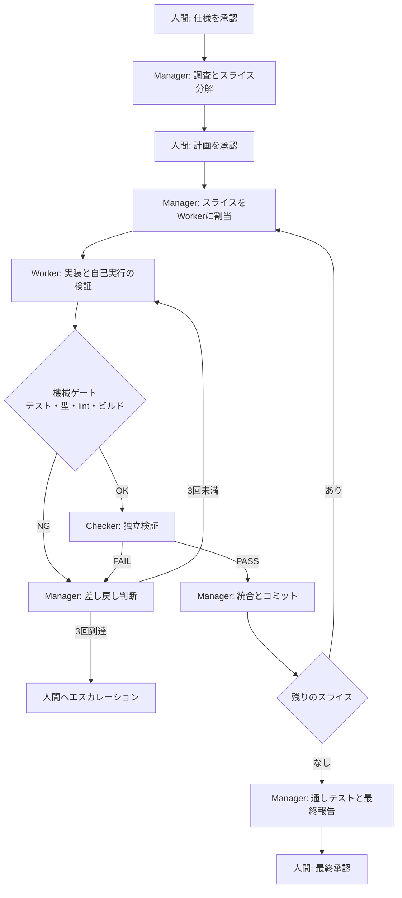

# AIに大きなタスクを任せる手法 — Manager→Worker→Checker構成

「この機能をまるごと作って」「このリポジトリをこの構成に作り替えて」——こうした大きなタスクをAIに一発で投げると、それらしい成果物は返ってきます。しかし、そのまま使えることはほとんどありません。要件と違う、既存の設計を壊す、直すほど別の場所が壊れる、といったことが起きます。

原因は主にモデルの性能ではなく、**任せ方の構造**です。大きなタスクは「正解が定義されていない・途中で確認できない・失敗しても気づけない」という性質を持ちます。

この記事の主張は次の一点です。

> **実装する者と、検証する者を分ける。そして、全体を持つ者(Manager)は書かず、判断と統合に徹する。**

人間のチームが大きな仕事を回すときの「担当者・レビュアー・リーダー」の分業を、AIエージェントでそのまま再現します。以下、失敗の構造 → 中核の構成 → 各役割の設計 → 運用ルール、の順にまとめます。

## 1. 大きなタスクが失敗する構造的な理由

| 原因 | 典型的な症状 | 対策(本記事での位置) |
|---|---|---|
| コンテキストの希薄化 | 序盤で決めた制約を忘れる。無関係なファイルを読み始める | Managerが仕様を保持し、Workerには必要分だけ渡す(§2, §5) |
| 誤差の複利 | 各ステップはほぼ正しいのに、最後には動かない | スライスごとに検証し、失敗を持ち越さない(§4, §7) |
| 仕様の空白をAIが埋める | 指示していない仕様をもっともらしく決める | 受け入れ条件と「やらないこと」を先に書く(§3) |
| 自己評価の甘さ | 実装者が「完了しました」と報告するが、実際は未完 | 独立したCheckerが検証する(§6) |
| 検証手段がない | 「動くはず」のまま変更が積み上がる | テスト・lint・型・CIで機械判定する(§7) |
| 状態が会話の中だけにある | セッションが切れると計画も進捗も消える | 台帳・引き継ぎメモに外部化する(§5, §12) |
| 変更が大きすぎる | レビュー不能、原因特定不能 | 縦切りで小さく出し、都度統合する(§4) |

### 1.1 誤差は掛け算で効く

1ステップの成功率が95%で、各ステップが**独立**だと仮定すると、連続成功の確率は次のとおりです(実際は相関があるため、あくまで目安です)。

```text
0.95^10 = 0.60
0.95^20 = 0.36
0.95^50 = 0.08
```

タスクが長くなるほど、単発の精度を上げるだけでは足りません。各ステップの後に必ず合否を確認し、**失敗を次のステップに持ち越さない仕組み**が必要です。

### 1.2 コンテキストは「広ければ安心」ではない

コンテキストウィンドウが大きくなっても、長い入力の中央部分の情報が使われにくくなる傾向(「lost in the middle」として研究されています)や、無関係な情報が増えるほど重要な制約への注意が薄まる傾向があります。**必要な情報だけを、必要なタイミングで渡す**設計が重要で、これは「コンテキストエンジニアリング」と呼ばれる考え方とほぼ同じです。

### 1.3 自己レビューは同じ思い込みを引き継ぐ

実装したAIに「間違いがないか確認して」と頼んでも、実装時と同じ前提・同じ盲点で見直すため、見落としが再現されがちです。人間でも、自分で書いた文章の誤字は見つけにくいのと同じです。**検証者は、実装の文脈を持たない別のエージェントにする**必要があります。これが本記事の中核です。

## 2. 全体像:Manager→Worker→Checkerの構成

### 2.1 役割

| 役割 | 責務 | やらないこと |
|---|---|---|
| **人間** | 仕様の承認、計画の承認、エスカレーション対応、最終承認 | 全差分の逐一レビュー |
| **Manager** | 仕様の保持、調査、スライス分解、割当、統合、完了判定、台帳の更新 | コードを書く(自分で実装し始めない) |
| **Worker** | 割り当てられた1スライスだけを実装し、自分で実行できる検証を回す | 担当範囲外の編集、仕様の解釈変更、テスト・CI設定の変更 |
| **Checker** | 仕様・受け入れ条件・差分・実行結果だけを根拠に、独立して検証しPASS/FAILを返す | コードの修正(指摘のみ)、Workerの自己評価を根拠にすること |
| **機械ゲート** | テスト・型・lint・ビルド・CIによる最終判定 | (人もAIも覆せない最終合否) |

### 2.2 フロー



ポイントは3つです。

1. **Workerの「完了」は完了ではない**。機械ゲートとCheckerを通って初めて、Managerが完了と認める。
2. **FAILはManager経由でWorkerに戻る**。CheckerがWorkerに直接指示すると、責任と状態管理が崩れる。
3. **一定回数で人間に戻す**。無限ループを構造的に防ぐ。

### 2.3 なぜこの分業が効くか

- **コンテキスト希薄化への対策**:Managerは「仕様・台帳・各スライスの合否と要約」だけを持ち、Workerの作業ログを抱えない。Workerは1スライス分の情報だけで動く。
- **自己評価バイアスの遮断**:Checkerは実装の経緯を知らない。
- **誤差の複利の遮断**:各スライスの合格が確認されるまで、次に進まない。
- **人間の負荷の最小化**:人間は「仕様」「計画」「エスカレーション」「最終報告」に集中できる。

## 3. 起点:仕様を「発注書」として固める

大きなタスクほど、最初の曖昧さが後半で増幅します。AIは曖昧な部分を「それらしく」埋めるのが得意なので、**書かなかったことは、意図と違う形で決まります**。Managerが保持し、Worker・Checkerに配る共通の基準として、次の発注書を `docs/specs/` に置きます。

```markdown
# 目的
何のためにやるのか。1〜3文。

# 非目的(今回やらないこと)
- 認証方式の変更はしない
- 既存APIのレスポンス形式は変えない
- パフォーマンス最適化は別タスク

# 受け入れ条件(実行できる形で)
- [ ] `pnpm test` が全件成功する
- [ ] 未ログインで /settings にアクセスすると /login にリダイレクトされる
- [ ] 既存の /api/users のレスポンスに変更がない

# 制約
- 技術スタック: TypeScript 5.x / React 18 / PostgreSQL 15
- 触ってよい範囲: src/features/settings/ 配下のみ
- 変更禁止: 既存のマイグレーション、テスト設定、CI設定

# 既存資産
- 参考にすべき実装: src/features/profile/
- 関連する設計メモ: docs/adr/0007-settings.md

# 完了の定義
- テスト追加、README更新、CI green、Checker全スライスPASS、人間の最終承認
```

### 3.1 「非目的」が最も効く

目的だけを書くと、AIは関連する改善まで一緒にやろうとし、差分が膨らみ、既存機能を壊します。**やらないことの明示**は、スコープ管理として最も費用対効果が高い項目です。

### 3.2 受け入れ条件は「判定できる形」で書く

Checkerが判定する基準でもあるため、主観的な言葉は使えません。

| 悪い例 | 良い例 |
|---|---|
| ログインできること | `POST /login` に正しい資格情報を送ると200とSet-Cookieが返る |
| 表示が速いこと | 一覧画面の初期表示がローカルで500ms以内(`pnpm measure`で計測) |
| エラー処理が適切なこと | 存在しないIDを指定すると404と `{"error":"not_found"}` を返す |
| コードがきれいなこと | `pnpm lint` と `pnpm typecheck` がエラー0件 |

### 3.3 仕様が曖昧なら「推測せず質問する」

最初に、次の規則を全エージェント共通で入れます。**仕様に書かれていない判断が必要になったら、推測で実装せず、Managerに質問する。Managerで解決できなければ人間に質問する。**

## 4. 分解:縦切りで「検証できる最小単位」にする

Managerは仕様を、レイヤごと(DB→API→UI)の**横切り**ではなく、ユーザー価値を端から端まで通す**縦切り**で分解します。

- 横切りは「全層が揃うまで動かない」ため、長い間フィードバックが得られません。
- 縦切りは1スライスごとに検証でき、失敗の影響範囲が小さく、途中で方針を変えられます。

例:「ユーザー設定画面の追加」

| # | スライス | 検証方法 |
|---|---|---|
| 1 | 設定の読み取りAPI(既存データのみ) | 結合テスト + curl |
| 2 | 設定画面の表示(読み取り専用) | 画面確認 + スナップショット |
| 3 | 表示名の更新API | 正常系・異常系テスト |
| 4 | 表示名の編集UI | E2E |
| 5 | メール通知設定の更新 | テスト + 手動確認 |
| 6 | バリデーションとエラー表示 | 異常系テスト |
| 7 | 監査ログの記録 | ログ確認テスト |

### 4.1 1スライスの目安

以下は経験則であり、プロジェクトに応じて調整してください。

- 差分が概ね300行以下、変更ファイルが10個以下
- Checkerと人間が1回で読み切れる
- 「終わったら何ができるようになるか」を1文で言える
- 独立してコミットできる(またはフラグで隠せる)

AIが速く書けるほど、**人間やCheckerのレビュー容量が律速**になります。スライスを小さく保つ最大の理由はここにあります。

### 4.2 依存順に並べ、不確実なものを先に

スライス間の依存を洗い出し、外部APIの仕様確認など**不確実性の高いものを先に**潰します。後回しにすると終盤に手戻りが集中します。

### 4.3 計画に含める項目

Managerが出す計画には、各スライスについて次の5点を含めます。

1. 触るファイル(新規・変更・削除)
2. 依存関係と順序
3. 検証方法(実行するコマンド)
4. リスクと代替案
5. ロールバック方法(フラグ、リバート、マイグレーションの戻し)

**この計画は、人間が承認してから実装に入ります**。「その方針は違う」と直すコストが最も安いのは、コードを書く前です。

## 5. Managerの設計

### 5.1 Managerは書かない

Managerが自分で実装を始めると、コンテキストが作業ログで埋まり、俯瞰と判断ができなくなります。Managerの出力は、**計画・割当・判定・台帳・報告**のみに限定します。

### 5.2 台帳(ledger)で状態を外に出す

Managerの状態は会話に置かず、ファイルやissueに置きます。

```markdown
# 台帳: settings機能

| # | スライス | 状態 | 差し戻し回数 | Checker結果 | コミット |
|---|---|---|---|---|---|
| 1 | 読み取りAPI | 完了 | 0 | PASS | a1b2c3d |
| 2 | 画面表示 | 完了 | 1 | PASS | d4e5f6a |
| 3 | 更新API | 実装中 | 0 | - | - |
| 4 | 編集UI | 未着手 | - | - | - |

## 決定事項
- バリデーションは zod(既存のprofile機能と統一)
- 楽観的更新は採用しない(競合時の挙動が未定義)

## 未解決の質問
- メール通知の既定値(人間に確認中)
```

仕様・計画・決定事項・進捗をすべて会話の外に置けば、コンテキストが圧縮されてもセッションが切れても復帰できます。

### 5.3 Managerプロンプト例

```text
あなたはManagerです。コードは書きません。

入力: docs/specs/settings.md(発注書)

手順:
1. 調査: 関連ファイルを列挙し、各役割を1行で説明する(読み取りのみ。並列の調査担当を使ってよい)
2. 計画: 発注書を満たす実装を、縦切りの検証可能なスライスに分解する。
   各スライスに「触るファイル・検証コマンド・リスク・ロールバック」を書く
3. 停止: 計画と台帳を提示し、人間の承認を待つ

承認後のルール:
- スライスは1つずつ(独立なものだけ並列)Workerに割り当てる
- Workerへの依頼には、そのスライスに必要な情報だけを渡す(全履歴は渡さない)
- Workerの完了報告は信用せず、機械ゲートとCheckerの結果で判定する
- FAILは原因を整理してWorkerに差し戻す。同一スライスで3回FAILしたら止めて人間に報告する
- 仕様にない判断が必要なら、推測せず人間に質問する
- 各スライス完了ごとに台帳を更新し、コミットする
```

## 6. Workerの設計

### 6.1 Workerへの依頼は「担当・範囲・完了条件」を固定する

```text
あなたはWorkerです。担当はスライス3「表示名の更新API」のみです。

【渡す情報】
- 発注書の該当部分(目的・非目的・受け入れ条件)
- 参考実装: src/features/profile/api.ts
- 触ってよい範囲: src/features/settings/api/

【禁止事項】
- 範囲外のファイルの編集(共通部品が必要なら変更せず「必要」と報告)
- 既存テスト・テスト設定・CI設定の変更や削除
- 依存パッケージの追加(必要なら報告)
- 仕様にない判断の推測実装(質問を返す)

【完了条件】
- `pnpm test src/features/settings` `pnpm typecheck` `pnpm lint` が成功

【報告形式】
## 変更内容(振る舞い単位)
## 実行したコマンドと結果
## 未対応・懸念(やらなかったこと、判断に迷った点)
```

### 6.2 「未対応・懸念」を必ず書かせる

隠れた手抜きや認識違いが、この欄で見つかります。空欄の報告は、かえって疑う材料になります。

## 7. 機械ゲート:最終判定は機械に

AIの「完了しました」は、完了の証明ではありません。**コマンドが成功した事実**だけを根拠にします。

- テスト(単体・結合・E2E)
- 型チェック(`pnpm typecheck`)
- lint / フォーマッタ
- ビルド
- CI(PRの必須チェック)

Checkerも同じAIなので誤判定します。したがって、**機械ゲートを最終判定とし、Checkerは機械では拾えない観点(仕様との整合、設計、抜け)を補う層**と位置づけます。

### 7.1 テストの扱い:改ざんを防ぎ、実装と切り離す

AIにありがちな失敗が2つあります。

1. **トートロジーなテスト**:実装の現在の挙動をそのまま期待値にして、バグを検出できない。
2. **テストの書き換え・削除・スキップ**:失敗するテストを通すために、テスト側を変更する。

対策として、次を運用します。

- **テストは受け入れ条件から導く**。可能ならテスト担当のWorkerを実装担当と別にする。
- **既存テスト・CI設定は変更禁止**。Checkerは差分から、テストの削除・スキップ(`skip`, `only`)・期待値の緩和・閾値の変更を必ず検知する。
- 新規テストには、正常系・境界値・異常系・既存機能の回帰を含める。

## 8. Checkerの設計

### 8.1 独立性が価値の源泉

Checkerの価値は「別の目で見ること」にあります。その独立性を保つため、渡す情報を限定します。

| 渡すもの | 渡さないもの |
|---|---|
| 発注書(目的・非目的・受け入れ条件) | Workerの推論過程・作業ログ |
| 差分(diff) | Workerの自己評価・完了報告の結論部分 |
| 機械ゲートの実行結果 | 「大丈夫なはず」といった実装者の意見 |
| 触ってよい範囲のリスト | |

Workerの「未対応・懸念」は、**確認すべき論点**として参照するのは有効ですが、結論としては渡しません。

### 8.2 Checkerが見る観点

1. **仕様適合**:受け入れ条件を一つずつ、実行結果や差分と照合して満たしているか
2. **スコープ逸脱**:非目的や範囲外への変更、不要な差分がないか
3. **テストの健全性**:テストの削除・スキップ・期待値の緩和、トートロジーがないか
4. **既存機能の回帰**:変更が既存の挙動に影響しないか
5. **セキュリティと安全**:権限チェック、入力検証、秘密情報の混入がないか
6. **未解決の推測**:仕様にない判断を勝手に決めていないか

### 8.3 判定の出力形式

曖昧な講評ではなく、Managerが機械的に扱える形式にします。

```text
あなたはCheckerです。コードの修正はしません。指摘のみ行います。

渡された情報: 発注書、差分、機械ゲートの結果
(実装者の意図や自己評価は渡されていません。差分から読み取れる事実だけを根拠にしてください)

出力形式:

## 判定: PASS または FAIL

## 受け入れ条件ごとの確認
- [条件1] 満たす/満たさない — 根拠(ファイル名・行・実行コマンドと結果)

## 指摘(FAILの場合)
- 重大度(blocker/major/minor)、場所、問題、再現コマンド、修正の方向性

## 確認できなかった点
- 情報不足で判定できなかった項目

ルール:
- 根拠のない指摘はしない。推測は「推測」と明記する
- テストの削除・スキップ・期待値の緩和があれば必ずblockerとして報告する
- 判定に迷ったらFAILとし、理由を書く
```

### 8.4 独立性をさらに高める工夫

- Workerと**別のセッション・別のプロンプト**で動かす(同一会話の延長にしない)。
- 可能ならWorkerと**別のモデル**を使う。同一モデルは盲点が共通しやすい。
- 重要なスライスでは、**仕様だけを渡して先にテストを書く担当**を分ける。
- Checkerの指摘は**再現コマンド付き**にし、Managerが事実確認できるようにする。

## 9. ループ制御と停止条件

差し戻しの連鎖は、放置すると同じ失敗の繰り返しに陥ります。次の規則を明文化します。

| 状況 | 対応 |
|---|---|
| 機械ゲートまたはChecker FAIL(1〜2回目) | 原因を整理してWorkerに差し戻す。「同じ指示の繰り返し」ではなく、指摘を添える |
| 同一スライスで3回FAIL | 停止して人間にエスカレーション。スライスの分割・仕様見直しを検討 |
| 仕様にない判断が必要 | 推測せずManagerへ質問、解決しなければ人間へ |
| 範囲外の変更が必要 | Workerは変更せず報告。Managerが計画を修正 |
| 想定外のエラーや破壊的操作の必要 | 即時停止して人間に確認 |
| Checkerの判定が機械ゲートと矛盾 | 機械ゲートを優先し、Checkerの根拠を確認 |

3回で止めるのは、**3回失敗した問題は、同じ方法の4回目では解けない**ことが多いためです。原因は、仕様の曖昧さ、スライスの粒度、環境のいずれかにあることが多く、人間の判断が必要です。

## 10. 並列化:読みは並列、書きは境界を切る

- **読み取り(調査・レビュー・検索)は並列化しやすい**。副作用がないため。
- **書き込みは、同じファイルを触ると競合する**。ファイルやモジュールで担当境界を切る。
- Manager(または統合担当)が、並列の成果をマージし、通しテストを回す。

並列化した分だけ**統合コストとレビュー負荷が増えます**。独立性が明確で、境界が切れるスライスに限定し、分割数は統合できる範囲に抑えます。

## 11. リポジトリの指示書(AGENTS.md / CLAUDE.md)

毎回のプロンプトでコマンドや規約を説明するのは無駄で、忘れられます。リポジトリ直下に指示書を置き、すべての役割(Manager・Worker・Checker)に参照させます。ファイル名はツールによって異なります(`AGENTS.md`、`CLAUDE.md`、`.github/copilot-instructions.md` など)が、役割は同じです。

| 書くこと | 書かないこと |
|---|---|
| ビルド・テスト・lintの正確なコマンド | 長々とした設計思想 |
| ディレクトリ構成と各層の責務 | 頻繁に変わる情報(バージョン番号など) |
| コーディング規約(命名、エラー処理、ログ) | 秘密情報・認証情報 |
| 触ってはいけない領域、生成物 | 一般的すぎて判断に使えない原則 |
| 停止条件、質問のルール | モデルが既に知っている言語仕様の説明 |

```markdown
# AGENTS.md

## セットアップ
- `pnpm install`
- 環境変数は `.env.example` をコピーして作成

## 検証(PR前に必須)
- `pnpm lint` / `pnpm typecheck` / `pnpm test` / `pnpm build`

## 構成
- `src/app/` ルーティングのみ。ロジックを書かない
- `src/features/<name>/` 機能単位。UI・hooks・APIを同居させる
- `src/lib/` 汎用ユーティリティ

## ルール
- 新規の依存追加は事前に相談
- `src/legacy/` は編集禁止
- 既存テスト・テスト設定・CI設定は変更禁止(失敗を通すための書き換えは不可)
- エラーは握りつぶさず、`Result` 型で返す

## 停止条件
- 仕様にない判断が必要なら、推測せず質問する
- 同じ修正が3回失敗したら止めて報告する
- 破壊的操作(データ削除、force push、マイグレーションの巻き戻し)は必ず人間に確認する

## PR
- 1PR = 1スライス。説明に「変更内容 / 検証結果 / 未対応」を書く
```

短く、具体的に、コピペで動く形で書きます。長すぎる指示書は読まれず、矛盾は混乱を招きます。

## 12. 権限と安全設計

エージェントに多くの権限を持たせるほど、事故の影響が大きくなります。

- **最小権限**:Workerには担当ディレクトリの書き込み権限だけを与える。Checkerには**読み取りと実行のみ**を与える。
- **サンドボックス**:開発用の隔離環境で動かし、本番の認証情報・データに触れさせない。
- **破壊的操作は承認制**:データ削除、`rm -rf`、force push、本番マイグレーション、外部への送信は、人間の承認なしに実行させない。
- **秘密情報**:`.env` や鍵をコンテキストや差分に含めない。Checkerは秘密情報の混入も確認する。
- **ブランチ運用**:作業はブランチで行い、mainへの直接変更を禁止する。ロールバック(リバート)が常に可能な状態を保つ。
- **外部入力は命令ではない**:Webページ・ファイル・issueの中の文章を、指示として実行させない(プロンプトインジェクション対策)。

## 13. 人間の役割

人間が全差分を読む運用は、AIの速度に追いつけず破綻します。人間は次に集中します。

| タイミング | 人間がやること |
|---|---|
| 開始時 | 発注書の作成・承認(特に非目的と受け入れ条件) |
| 計画時 | Managerの計画(分解・順序・リスク・ロールバック)の承認 |
| 実行中 | エスカレーション(3回FAIL、仕様の質問、破壊的操作)への対応 |
| 完了時 | Managerの最終報告と、台帳・機械ゲートの確認、重要な差分の抜き取りレビュー |

## 14. 引き継ぎメモ

セッションをまたぐ場合、区切りごとに台帳とは別に次を残します。

```markdown
# 引き継ぎメモ(2026-11-22 15:30)

## 現在地
- 完了: スライス1〜3
- 進行中: スライス4(編集UI)— フォームの状態管理まで実装済み、Checker未実施

## 決めたこと
- バリデーションは zod を使う

## 次にやること
1. 保存ボタンのエラーハンドリング
2. E2Eテスト追加(tests/e2e/settings.spec.ts)

## 失敗したこと・注意
- `useSettings` をグローバルに持つ案は、再レンダリング過多で却下
- `src/legacy/` は触らない(別チームが移行中)
```

## 15. 適用範囲:タスクの大きさで構成を変える

この構成は、コストと遅延が増えます。**すべてのタスクに必要なわけではありません**。

| 規模 | 目安 | 構成 |
|---|---|---|
| 小 | 数ファイル・1時間未満 | 1エージェント + 機械ゲート。発注書は3行程度(目的・非目的・受け入れ条件) |
| 中 | 〜数日、複数スライス | Manager + Worker + 機械ゲート。重要スライスのみChecker |
| 大 | 週単位、複数モジュール、リスク高 | Manager + Worker + Checker + 並列 + 人間の承認ゲート |

判断の軸は、**失敗したときの被害の大きさ**と**やり直しコスト**です。認証・課金・データ移行など影響の大きい領域は、小さくても厚い検証を入れます。

## 16. 実践:1日の進め方(中〜大規模の例)

| 時間 | やること | 成果物 |
|---|---|---|
| 30分 | 人間が発注書を書く | `docs/specs/*.md` |
| 20分 | Managerが調査(並列可) | ファイル一覧・依存関係 |
| 15分 | Managerがスライス分解、人間が計画を承認 | 台帳・計画 |
| 2〜3時間 | スライスごとに Worker→機械ゲート→Checker→統合 | 小さなコミット列 |
| 30分 | 通しテスト、Managerの最終報告、人間の最終承認、引き継ぎメモ | CI green、次回の起点 |

最初の約65分は、コードを書かずに使います。ここを飛ばすと、後半で数時間失います。

## 17. アンチパターンと処方

| アンチパターン | 何が起きるか | 処方 |
|---|---|---|
| 実装者に自己レビューをさせる | 同じ盲点を引き継ぎ、問題が残る | 独立したCheckerを置く |
| Managerが自分で実装を始める | コンテキストが埋まり、俯瞰・判定ができなくなる | Managerは書かない。役割を分ける |
| Workerの完了報告を信じる | 未完・手抜きが通る | 機械ゲートとCheckerで判定する |
| Checkerに実装の経緯を渡す | 独立性が失われ、同調する | 仕様・差分・結果だけを渡す |
| テストをAIが書き換えて通す | 見かけ上のgreenが発生 | テスト・CI設定の変更禁止、差分での検知 |
| 失敗したら同じ指示を繰り返す | 同じ失敗を繰り返す | 3回で止めて原因を見直す |
| 全部入りの巨大プロンプト | 制約が埋もれる | 仕様をファイル化し、スライスごとに必要分を渡す |
| 仕様を会話だけで決める | セッション終了で消える | 発注書を書いてから開始 |
| 同じファイルを並列で編集させる | 競合・上書き | 境界を切り、統合役を置く |
| 「いい感じに」で丸投げする | AIが勝手に仕様を決める | 受け入れ条件と非目的を明示 |
| 大きすぎるPRを1本作る | レビュー不能 | 縦切りで分割し、都度統合 |
| 小タスクに重い構成を入れる | コストと遅延だけ増える | §15で規模に合わせる |

## 18. 導入チェックリスト

**仕様と計画**
- ☐ 目的が1〜3文で書かれている
- ☐ 「やらないこと」が列挙されている
- ☐ 受け入れ条件がコマンドまたは観測可能な入出力になっている
- ☐ 触ってよい範囲と禁止範囲が明示されている
- ☐ スライスに分かれ、各スライスに検証方法とロールバック方法がある
- ☐ 計画を人間が承認した

**役割と検証**
- ☐ Manager・Worker・Checkerの責務と禁止事項が書かれている
- ☐ CheckerにWorkerの推論や自己評価を渡さない運用になっている
- ☐ 判定がPASS/FAIL+根拠+再現コマンドの形式に統一されている
- ☐ テスト・CI設定の変更禁止と、改ざん検知が入っている
- ☐ 機械ゲート(テスト・型・lint・ビルド)のコマンドが決まっている

**運用と安全**
- ☐ 差し戻し3回でエスカレーションする規則がある
- ☐ 「推測せず質問する」ルールがある
- ☐ 破壊的操作が承認制になっている。権限が最小化されている
- ☐ 台帳と引き継ぎメモの置き場所がある

## 19. まとめ

大きなタスクをAIに任せるコツは、AIを賢くすることではなく、**タスクの形と、責任の分け方を変えること**です。

1. **実装と検証を分ける** — Worker が書き、独立した Checker が確かめる
2. **Managerは書かず、判断と統合に徹する** — 仕様・台帳・合否を持つ
3. **仕様を固定する** — 目的・非目的・受け入れ条件をファイルに書く
4. **縦切りで小さくする** — 1スライス=1検証=1レビュー
5. **最終判定は機械に** — テスト・型・lint・CIが最終ゲート、Checkerは補助
6. **止める条件を決める** — 3回失敗、仕様不明、破壊的操作は人間へ
7. **状態を会話の外に出す** — 台帳と引き継ぎメモ
8. **権限を絞り、規模に合わせる** — 最小権限、小タスクは軽く

結局のところ、これはAI特有の話ではなく、**良いチームの作り方**の話です。担当者・レビュアー・リーダーを分け、完了の定義を機械で判定できるようにし、詰まったら人に戻す。それができれば、AIは「それらしい成果物」ではなく「検証済みの成果物」を返してくれるようになります。

まずは次の1タスクで、「発注書を書く」「Workerとは別セッションでCheckerを走らせる」の2つだけ試してみてください。

## 参考(キーワード)

具体的なURLは公開前に確認のうえ追記してください。

- "Lost in the Middle: How Language Models Use Long Contexts"(長いコンテキストの中央部の利用率低下に関する研究)
- コンテキストエンジニアリング(エージェント向けの文脈設計に関する各社・各コミュニティの解説)
- 各ツールのエージェント指示書の仕様(AGENTS.md、CLAUDE.md、サブエージェントに関するドキュメント)