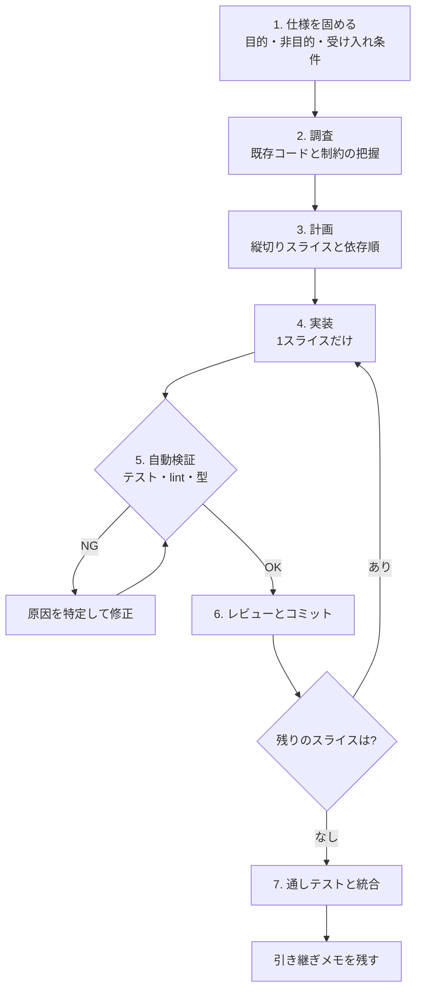

# AIに大きなタスクを任せる手法

「この機能をまるごと作って」「このリポジトリをこの構成に作り替えて」——こうした大きなタスクをAIに一発で投げると、それらしい成果物は返ってきます。しかし、そのまま使えることはほとんどありません。要件と違う、既存の設計を壊す、直しているうちに別の場所が壊れる、といったことが起きます。

これは主にモデルの性能の問題ではなく、**任せ方の問題**です。大きなタスクは、そのままでは「正解が定義されていない・途中で確認できない・失敗しても気づけない」という3つの性質を持っています。この記事では、それを小さくて検証可能な作業の列に変換するための実践的な手法をまとめます。

## 1. 大きなタスクが失敗する構造的な理由

まず、失敗の原因を分けて捉えます。原因が分かれば、対策はほぼ機械的に決まります。

| 原因 | 典型的な症状 | 対策 |
|---|---|---|
| コンテキストの希薄化 | 会話の序盤で決めた制約を忘れる。無関係なファイルを読み始める | 仕様をファイルに固定し、毎回参照させる |
| 誤差の複利 | 各ステップは95%の確率で正しいのに、最後には動かない | ステップを短くし、各段で検証する |
| 仕様の空白をAIが埋める | 指示していない仕様を、もっともらしく決めて実装する | 受け入れ条件と「やらないこと」を先に書く |
| 検証手段がない | 「動くはず」のまま変更が積み上がる | テスト・lint・型・CIで合否を機械判定する |
| 状態が会話の中だけにある | セッションが切れると計画も進捗も消える | todo・issue・計画ファイルに外部化する |
| 変更が大きすぎる | レビューできない、壊れた原因を特定できない | 縦切りで小さく出して都度統合する |

### 1.1 誤差は足し算ではなく掛け算で効く

見落としがちなのが、これです。1ステップの成功率が95%でも、20ステップ連続で成功する確率は **0.95<sup>20</sup> ≒ 36%** しかありません。

```text
0.95^10 = 0.60
0.95^20 = 0.36
0.95^50 = 0.08
```

つまり、**タスクを長くするほど、単発の精度を上げるだけでは足りなくなる**。だから「もっと賢いモデルを使う」だけでなく、各ステップの後に必ず合否を確認して、失敗を次のステップに持ち越さない仕組みが必要になります。

### 1.2 コンテキストは「広ければ安心」ではない

コンテキストウィンドウが大きくなっても、長い入力の中央部分の情報は使われにくくなる（"lost in the middle"）ことが知られています。また、無関係な情報が増えるほど、重要な制約に割かれる注意は薄まります。

したがって、大量のファイルをとにかく読ませるのではなく、**そのタスクに必要な情報だけを、必要なタイミングで渡す**設計が重要です。これは最近「コンテキストエンジニアリング」と呼ばれている考え方とほぼ同じです。

## 2. 全体像：7つの原則

本記事で扱う手法は、次の流れに集約できます。



以下、原則ごとに具体的なやり方を見ていきます。

## 3. 原則1：仕様を「発注書」として先に固める

大きなタスクほど、最初の仕様の曖昧さが後半で増幅します。AIは曖昧な部分を「それらしく」埋めるのが得意なので、**書かなかったことは、意図とは違う形で決まります**。

最低限、次の6項目を埋めた発注書を用意します。

```markdown
# 目的
何のためにやるのか。1〜3文。

# 非目的（今回やらないこと）
- 例: 認証方式の変更はしない
- 例: 既存APIのレスポンス形式は変えない
- 例: パフォーマンス最適化は別タスク

# 受け入れ条件
- [ ] `npm test` が全件成功する
- [ ] 未ログインで /settings にアクセスすると /login にリダイレクトされる
- [ ] 既存の /api/users のレスポンスに変更がない

# 制約
- 技術スタック: TypeScript 5.x / React 18 / PostgreSQL 15
- 触ってよい範囲: src/features/settings/ 配下のみ
- 互換性: 既存のマイグレーションは変更しない

# 既存資産
- 参考にすべき実装: src/features/profile/
- 関連する設計メモ: docs/adr/0007-settings.md

# 完了の定義
- テスト追加、README更新、CI green、レビュー承認
```

### 3.1 「非目的」が一番よく効く

目的だけを書くと、AIは関連する改善まで一緒にやろうとします。すると差分が膨らみ、レビューが難しくなり、既存機能を壊します。**やらないことを明示する**のが、スコープ管理として最も費用対効果が高いです。

### 3.2 受け入れ条件は「実行できる形」で書く

| 悪い例 | 良い例 |
|---|---|
| ログインできること | `POST /login` に正しい資格情報を送ると200とSet-Cookieが返る |
| 表示が速いこと | 一覧画面の初期表示がローカルで500ms以内（`pnpm measure`で計測） |
| エラー処理が適切なこと | 存在しないIDを指定すると404と `{"error":"not_found"}` を返す |
| コードがきれいなこと | `npm run lint` と `tsc --noEmit` がエラー0件 |

主観的な言葉は、AIにも人間にも判定できません。**コマンドか、観測可能な入出力に落とし込む**のがコツです。

## 4. 原則2：縦切りで「検証できる最小単位」に分解する

仕様が固まったら、実装をスライスに分けます。このとき、レイヤごと（DB → API → UI）に分ける**横切り**ではなく、ユーザー価値の端から端までを通す**縦切り**で切ります。

- 横切りは「全部の層が揃うまで動かない」ため、長い間フィードバックが得られません。
- 縦切りは1スライスごとに動作確認でき、失敗しても影響範囲が小さく、途中で方針を変えられます。

たとえば「ユーザー設定画面の追加」なら、次のように切ります。

| # | スライス | 検証方法 |
|---|---|---|
| 1 | 設定の読み取りAPI（既存データのみ） | 結合テスト + curl |
| 2 | 設定画面の表示（読み取り専用） | 画面確認 + スナップショット |
| 3 | 表示名の更新API | 正常系・異常系のテスト |
| 4 | 表示名の編集UI | 手動確認 + E2E |
| 5 | メール通知設定の更新 | テスト + 手動確認 |
| 6 | バリデーションとエラー表示 | 異常系テスト |
| 7 | 監査ログの記録 | ログ確認テスト |

### 4.1 1スライスの目安

- 差分が概ね300行以下、変更ファイルが10個以下
- 1回のレビューで全体を読み切れる
- 「このスライスが終わったら何ができるようになるか」を1文で言える
- 独立してコミット・リリースできる（またはフラグで隠せる）

大きすぎたら切る、小さすぎたらまとめる。この判断を最初の計画段階でやっておくと、実装中の迷いが減ります。

### 4.2 依存関係を先に並べる

スライス間の依存を洗い出し、**ブロッカーになるものを先に潰します**。たとえば外部APIの仕様確認が未確定なら、それを最初の調査タスクにします。不確実性の高いものを後回しにすると、終盤で手戻りが集中します。

## 5. 原則3：調査・計画・実装を分ける

いきなりコードを書かせると、AIは目の前のファイルだけを見て局所的な実装をします。そこで、**調査 → 計画 → 実装**の3段階に分け、計画のレビューを挟みます。

```text
まず実装はしないでください。次の順で進めてください。

1. 調査: このリポジトリで設定画面に関係するファイルを列挙し、
   それぞれの役割を1行で説明してください。
2. 計画: 上の仕様（docs/specs/settings.md）を満たす実装を、
   検証可能なスライスに分けてください。
   各スライスについて、変更するファイル・検証方法・リスクを書いてください。
3. 停止: 計画を提示したら、私の承認を待ってください。
```

計画には次の5点を含めさせます。

1. **触るファイル**（新規・変更・削除）
2. **変更の順序**（依存関係）
3. **各スライスの検証方法**（実行するコマンド）
4. **リスクと代替案**（壊れそうな既存機能、判断が必要な点）
5. **ロールバック方法**（フラグ、リバート、マイグレーションの戻し）

ここで人間が「その方針は違う」「そのファイルは触らないで」と直すだけで、実装後の手戻りが大きく減ります。**コードを書かせる前に、方針をレビューする**のがポイントです。

## 6. 原則4：計画と進捗を会話の外に出す

AIとの会話は、タスクが長引くほど不安定になります。コンテキストが圧縮されたり、セッションが切れたり、別の作業を挟んだりすると、それまでの決定事項が失われます。

そこで、**状態を会話ではなくファイルやチケットに置きます**。

- **仕様**: `docs/specs/*.md`（発注書）
- **計画**: エージェントのtodoリスト、または issue のチェックリスト
- **決定事項**: ADR（`docs/adr/`）や issue のコメント
- **進捗**: PRの説明、コミットメッセージ
- **引き継ぎ**: セッション終了時のメモ

### 6.1 引き継ぎメモのテンプレート

セッションをまたぐ可能性があるなら、区切りごとに次の形で残します。

```markdown
# 引き継ぎメモ（2026-11-22 15:30）

## 現在地
- 完了: スライス1〜3（読み取りAPI、表示、更新API）
- 進行中: スライス4（編集UI）— フォームの状態管理まで実装済み

## 決めたこと
- バリデーションは zod を使う（既存の profile 機能と統一）
- 楽観的更新は採用しない（競合時の挙動が未定義のため）

## 次にやること
1. 保存ボタンのエラーハンドリング
2. E2Eテスト追加（tests/e2e/settings.spec.ts）

## 失敗したこと・注意
- `useSettings` をグローバルに持つ案は、再レンダリング過多で却下
- `src/legacy/` は触らない（別チームが移行中）
```

このメモがあると、別セッションのAIでも数分で同じ文脈に戻れます。人間のチームでも同じ効果があります。

## 7. 原則5：合否は機械に判定させる

AIの「完了しました」は、完了の証明ではありません。**コマンドが成功した事実**だけを完了条件にします。

- テスト（単体・結合・E2E）
- 型チェック（`tsc --noEmit` など）
- lint / フォーマッタ
- ビルド
- CI（PRの必須チェック）

### 7.1 テストは「実装に合わせて」書かせない

AIにテストを書かせると、実装の現在の挙動をそのまま期待値にする**トートロジーなテスト**ができがちです。それではバグを検出できません。次のように、仕様から導くことを明示します。

```text
テストは実装コードを読む前に、仕様の受け入れ条件だけを根拠に書いてください。
最低限、次のケースを含めてください。
- 正常系
- 境界値（空文字、0件、最大件数）
- 異常系（権限なし、存在しないID、不正な入力）
- 既存機能の回帰（壊してはいけない動作）
```

また、**テストを先に書かせる**（または実装と同時に書かせる）と、実装に引っ張られにくくなります。

### 7.2 完了報告のフォーマットを決める

```text
完了報告は次の形式でお願いします。

## 変更内容
- 箇条書き（ファイル単位ではなく、振る舞い単位）

## 検証結果
- 実行したコマンドと結果（成功/失敗、件数）

## 未対応・懸念
- 今回やらなかったこと
- 判断に迷った点、レビューしてほしい点
```

「未対応・懸念」を必ず書かせると、隠れた手抜きや認識違いが見つかりやすくなります。

## 8. 原則6：リポジトリに指示書を置く

毎回のプロンプトでビルドコマンドや規約を説明するのは無駄ですし、忘れられます。リポジトリ直下に指示書を置き、AIに常に参照させます。

代表的には `AGENTS.md`、`CLAUDE.md`、`.github/copilot-instructions.md` などがあります（ツールによって名前は異なりますが、役割は同じです）。

### 8.1 書くこと・書かないこと

| 書くこと | 書かないこと |
|---|---|
| ビルド・テスト・lintの正確なコマンド | 長々とした設計思想の説明 |
| ディレクトリ構成と各層の責務 | 頻繁に変わる情報（バージョン番号など） |
| コーディング規約（命名、エラー処理、ログ） | 秘密情報・認証情報 |
| 触ってはいけない領域、生成物、vendored code | 一般的すぎて判断に使えない原則 |
| PR・コミットの作法 | モデルが既に知っている言語仕様の説明 |

短く、具体的に、コピペで動く形で書きます。長すぎる指示書は読まれず、矛盾した指示は混乱を招きます。

```markdown
# AGENTS.md

## セットアップ
- `pnpm install`
- 環境変数は `.env.example` をコピーして作成

## 検証（PR前に必須）
- `pnpm lint`
- `pnpm typecheck`
- `pnpm test`
- `pnpm build`

## 構成
- `src/app/` ルーティングのみ。ロジックを書かない
- `src/features/<name>/` 機能単位。UI・hooks・APIを同居させる
- `src/lib/` 汎用ユーティリティ

## ルール
- 新規の依存追加は事前に相談
- `src/legacy/` は編集禁止
- エラーは握りつぶさず、`Result` 型で返す
- テストは `*.test.ts`、E2Eは `tests/e2e/`

## PR
- 1PR = 1スライス。説明に「変更内容 / 検証結果 / 未対応」を書く
```

## 9. 原則7：並列化は「読み」から、書き込みは境界を切って

タスクが大きいと、調査や独立した実装を並列化したくなります。ただし、並列化には明確な条件があります。

- **読み取り（調査・レビュー・検索）は並列化しやすい**。互いに副作用がないため。
- **書き込み（編集）は同じファイルを触ると競合する**。境界をファイルやモジュールで分け、統合役を決める。

サブエージェントや複数セッションに仕事を渡すときは、次の形で依頼します。

```text
あなたの担当は src/features/settings/ 配下のみです。
- 他ディレクトリのファイルは編集しないでください
- 共通コンポーネントが必要なら、変更せずに「必要」と報告してください
- 完了条件は `pnpm test src/features/settings` の成功です
- 結果は「変更ファイル / 検証結果 / 他担当への依頼」の形式で報告してください
```

最後に必ず統合役が通しテストを実行します。**並列化した分だけ、統合のコストが増える**ことを前提に、分割数を決めます。

## 10. 実践：半日〜1日の進め方

実際の進め方の例です。タスクの大きさに応じて圧縮してください。

| 時間 | やること | 成果物 |
|---|---|---|
| 30分 | 発注書を書く（目的・非目的・受け入れ条件） | `docs/specs/*.md` |
| 20分 | 並列で調査（関連ファイル、既存実装、制約） | ファイル一覧と依存関係 |
| 15分 | スライスに分解し、依存順に並べる | todo / issueのチェックリスト |
| 2〜3時間 | スライスごとに 実装 → 検証 → コミット | 小さなPR（またはコミット） |
| 30分 | 通しテスト、セルフレビュー、引き継ぎメモ | CI green、次回の起点 |

ポイントは、**最初の65分をコードを書かずに使う**ことです。ここを飛ばすと、後半で数時間失います。

## 11. アンチパターンと処方

| アンチパターン | 何が起きるか | 処方 |
|---|---|---|
| 全部入りの巨大プロンプト | 制約が埋もれ、後半で無視される | 仕様をファイル化し、スライスごとに渡す |
| 仕様を会話だけで決める | セッション終了で消える。解釈がぶれる | 発注書を書いてから開始する |
| 失敗したら同じ指示を繰り返す | 同じ失敗を繰り返す | 原因を特定し、指示か環境を変える |
| 生成コードを読まずに次へ進む | 誤りが複利で積み上がる | 各スライスで差分を確認する |
| テストを最後にまとめて書く | 実装に合わせたテストになる | 受け入れ条件から先に書く |
| 同じファイルを並列で編集させる | 競合・上書き・意味の崩壊 | 境界を切り、統合役を置く |
| 「いい感じに」で丸投げする | AIが勝手に仕様を決める | 受け入れ条件と非目的を明示する |
| 大きすぎるPRを1本作る | レビュー不能、原因特定不能 | 縦切りで分割し、都度統合する |

## 12. 導入チェックリスト

大きなタスクを任せる前に、次を確認します。

- ☐ 目的が1〜3文で書かれている
- ☐ 「やらないこと」が列挙されている
- ☐ 受け入れ条件がコマンドまたは観測可能な入出力になっている
- ☐ 触ってよい範囲と、触ってはいけない範囲が明示されている
- ☐ 既存の参考実装・設計メモへのポインタがある
- ☐ スライスに分かれ、各スライスに検証方法がある
- ☐ 依存順に並び、ブロッカーが先頭にある
- ☐ 実装前に計画をレビューした
- ☐ テスト・lint・型・ビルドのコマンドが決まっている
- ☐ 進捗と決定事項を残す場所（todo / issue / メモ）がある
- ☐ セッションをまたぐ場合の引き継ぎ形式が決まっている

## 13. まとめ

大きなタスクをAIに任せるコツは、AIを賢くすることではなく、**タスクの形を変えること**にあります。

1. **仕様を固定する** — 目的・非目的・受け入れ条件をファイルに書く
2. **縦切りで小さくする** — 1スライス＝1検証＝1レビュー
3. **調査と実装を分ける** — 計画をレビューしてから書かせる
4. **状態を外に出す** — 会話ではなくファイル・チケット・引き継ぎメモに残す
5. **合否を機械に決めさせる** — テスト・lint・型・CIを完了条件にする
6. **指示書を整備する** — 毎回の説明をリポジトリに移す
7. **並列化は境界を切ってから** — 読みは並列、書きは統合役を置く

結局のところ、これはAI特有の話ではなく、**良いタスク管理の話**でもあります。人間のチームに大きな仕事を任せるときと同じように、目的・範囲・完了条件・進捗の置き場所を決める。それができれば、AIは「それらしい成果物」ではなく「使える成果物」を返してくれるようになります。

まずは次の1タスクで、発注書を書くところだけ試してみるのがおすすめです。それだけで結果が変わるはずです。
